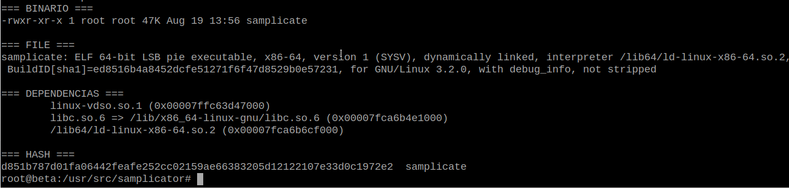

# Compilando e implantando o Samplicator em ambiente isolado no Debian 12

## Objetivo

Este procedimento documenta a compilação e implantação do **Samplicator** em um servidor Debian 12 utilizado para recepção de syslog via UDP.

O objetivo foi introduzir o Samplicator na frente do `syslog-ng`, permitindo duplicar o fluxo UDP para mais de um destino e, ao mesmo tempo, **preservar o endereço IP original dos equipamentos emissores**.

A compilação foi realizada em um **rootfs Debian descartável**, executado dentro de namespaces Linux. Dessa forma, nenhuma dependência adicional de compilação precisou ser instalada no sistema hospedeiro durante o procedimento.


------------------------------------------------------------------------

## Arquitetura

### Antes

``` text
Equipamentos
     |
     | UDP/514
     v
+-----------+
| syslog-ng |
+-----------+
     |
     +----> arquivos locais
     |
     +----> servidor syslog remoto UDP/514
            com spoof-source(yes)
```

### Depois

``` text
Equipamentos
     |
     | UDP/514
     v
+-------------+
| Samplicator |  -S
+-------------+
     |
     +----> 127.0.0.1:5514 ----> syslog-ng ----> arquivos locais
     |
     +----> servidor syslog remoto:514
```

O Samplicator passa a ser o processo responsável por `0.0.0.0:514/UDP`.

O `syslog-ng` deixa de receber diretamente da rede e passa a escutar apenas em `127.0.0.1:5514/UDP`.

A opção `-S` do Samplicator mantém --- por spoofing --- o endereço de origem dos datagramas UDP. Isso foi validado experimentalmente antes da implantação.

------------------------------------------------------------------------

## Ambiente utilizado

Servidor de compilação/produção:

``` text
Sistema operacional: Debian GNU/Linux 12 (bookworm)
Arquitetura:         amd64 / x86_64
Kernel:              6.1
CPU:                 Intel Xeon E5620 @ 2.40 GHz
```

Ferramentas necessárias para criar o ambiente isolado já disponíveis no host:

``` text
/usr/bin/unshare
/usr/bin/nsenter
/usr/bin/mount
```

O rootfs temporário foi criado em `/tmp`, que possuía espaço suficiente para a operação.

------------------------------------------------------------------------

## 1. Obtenção do debootstrap sem instalá-lo

Para evitar instalar `debootstrap` no host, o pacote foi apenas baixado:

``` bash
cd /tmp

apt-get download debootstrap

ls -lh debootstrap_*.deb
```

Em seguida, o conteúdo do pacote foi extraído manualmente:

``` bash
mkdir -p /tmp/samp-build/debootstrap

dpkg-deb -x \
    /tmp/debootstrap_*.deb \
    /tmp/samp-build/debootstrap
```

O executável extraído ficou disponível em:

``` text
/tmp/samp-build/debootstrap/usr/sbin/debootstrap
```

Ao executá-lo diretamente, o script inicialmente procurou seus arquivos auxiliares no caminho padrão `/usr/share/debootstrap`.

Como o pacote não estava instalado no host, foi necessário indicar explicitamente o diretório extraído:

``` bash
DEBOOTSTRAP_DIR=/tmp/samp-build/debootstrap/usr/share/debootstrap \
    /tmp/samp-build/debootstrap/usr/sbin/debootstrap --version
```

Resultado utilizado:

``` text
debootstrap 1.0.128+nmu2+deb12u2
```

------------------------------------------------------------------------

## 2. Criação do rootfs Debian descartável

Foi criado um Debian 12 mínimo:

``` bash
mkdir -p /tmp/samp-build/rootfs

DEBOOTSTRAP_DIR=/tmp/samp-build/debootstrap/usr/share/debootstrap \
    /tmp/samp-build/debootstrap/usr/sbin/debootstrap \
    --variant=minbase \
    bookworm \
    /tmp/samp-build/rootfs \
    http://deb.debian.org/debian
```

Ao término:

``` text
Base system installed successfully.
```

O rootfs ocupava aproximadamente:

``` text
203 MB
```

Validação:

``` bash
cat /tmp/samp-build/rootfs/etc/os-release

ls -l /tmp/samp-build/rootfs/usr/bin/gcc 2>/dev/null \
    || echo "gcc não existe no rootfs"

ls -l /tmp/samp-build/rootfs/usr/bin/make 2>/dev/null \
    || echo "make não existe no rootfs"
```

Resultado:

``` text
gcc não existe no rootfs
make não existe no rootfs
```

------------------------------------------------------------------------

## 3. Criação do namespace de compilação

O ambiente foi iniciado usando namespaces de mount, UTS, IPC e PID:

``` bash
unshare --mount --uts --ipc --pid --fork \
    chroot /tmp/samp-build/rootfs /bin/bash
```

Dentro do ambiente:

``` bash
hostname samp-build
mount -t proc proc /proc
```

Validação:

``` bash
echo "PID shell=$$"

readlink /proc/1/ns/pid
readlink /proc/$$/ns/pid

command -v gcc || echo "gcc ausente"
command -v make || echo "make ausente"
```

O shell passou a ser o **PID 1 do novo namespace**:

``` text
PID shell=1
gcc ausente
make ausente
```

Os identificadores de namespace de `/proc/1` e do shell também eram iguais, confirmando que ambos pertenciam ao novo PID namespace.

### Lição durante a implantação

Na primeira tentativa de validação, `/proc` ainda permitia visualizar processos do host. Isso foi detectado porque `ps` apresentava o `systemd` real do servidor como PID 1.

O teste foi descartado e o procedimento corrigido.

Essa validação é importante: **executar `unshare --pid` sem verificar o resultado não é prova suficiente de isolamento**. É recomendável confirmar explicitamente o PID 1 e os identificadores em `/proc/*/ns/`.

------------------------------------------------------------------------

## 4. Instalação do toolchain dentro do rootfs

Depois de validar o isolamento:

``` bash
apt-get update

apt-get install -y \
    build-essential \
    git \
    ca-certificates
```

Posteriormente foram necessários os componentes do Autotools:

``` bash
apt-get install -y \
    autoconf \
    automake
```

Versões utilizadas:

``` text
gcc      12.2.0
GNU Make 4.3
git      2.39.5
autoconf 2.71
automake 1.16.5
```

------------------------------------------------------------------------

## 5. Obtenção do Samplicator

O código-fonte foi obtido do repositório upstream:

``` bash
cd /usr/src

git clone https://github.com/sleinen/samplicator.git

cd samplicator
```

Foram verificadas as tags disponíveis:

``` bash
git tag --sort=-version:refname
```

Entre as versões encontradas:

``` text
v1.3.6
v1.3.5
1.3.8rc1
```

Foi escolhida a versão estável:

``` bash
git checkout v1.3.6
```

A escolha de uma tag, em vez de simplesmente compilar o `master`, torna o processo operacionalmente reproduzível.

------------------------------------------------------------------------

## 6. Preparação do sistema de build

A tag `v1.3.6` utiliza uma estrutura Autotools antiga, com arquivos como:

``` text
configure.in
acconfig.h
Makefile.am
```

Por isso, o sistema de configuração foi regenerado:

``` bash
autoreconf -fi
```

Em seguida:

``` bash
./configure --prefix=/usr/local
```

O `configure` terminou criando:

``` text
Makefile
config.h
```

------------------------------------------------------------------------

## 7. Compilação

A compilação foi executada sem instalar o programa:

``` bash
make -j"$(nproc)"
```

O executável produzido foi:

``` text
/usr/src/samplicator/samplicate
```

Validação:

``` bash
ls -lh samplicate
file samplicate
ldd samplicate
sha256sum samplicate
```

Resultado:

``` text
ELF 64-bit LSB pie executable
x86-64
dynamically linked
interpreter /lib64/ld-linux-x86-64.so.2
```

Dependências:

``` text
libc.so.6
/lib64/ld-linux-x86-64.so.2
```

SHA-256 do artefato compilado:

``` text
d851b787d01fa06442feafe252cc02159ae66383205d12122107e33d0c1972e2
```

O help também foi validado:

``` bash
./samplicate -h
```



------------------------------------------------------------------------

## 8. Instalação do binário no host

Depois de sair do namespace:

``` bash
exit
```

Foi criado um diretório específico para o software:

``` bash
mkdir -p /opt/samplicator/bin
```

O artefato foi copiado diretamente do rootfs:

``` bash
install -o root -g root -m 0755 \
    /tmp/samp-build/rootfs/usr/src/samplicator/samplicate \
    /opt/samplicator/bin/samplicate
```

A integridade foi novamente verificada:

``` bash
sha256sum /opt/samplicator/bin/samplicate
```

Resultado:

``` text
d851b787d01fa06442feafe252cc02159ae66383205d12122107e33d0c1972e2
```

O hash idêntico comprova que o artefato instalado é exatamente o executável validado dentro do ambiente de compilação.

------------------------------------------------------------------------

## 9. Teste funcional UDP

Antes de utilizar a porta de produção, foi realizado um teste com portas alternativas.

Listener:

``` bash
nc -u -l -p 6514
```

Samplicator:

``` bash
/opt/samplicator/bin/samplicate \
    -p 5514 \
    127.0.0.1/6514
```

Envio:

``` bash
echo '<13>Aug 19 14:00:00 teste samplicator: TESTE-UDP-OK' \
    | nc -u -w1 127.0.0.1 5514
```

O listener recebeu:

``` text
<13>Aug 19 14:00:00 teste samplicator: TESTE-UDP-OK
```

Isso comprovou o encaminhamento:

``` text
UDP/5514 -> Samplicator -> UDP/6514
```


------------------------------------------------------------------------

## 10. Teste de preservação do IP de origem

O requisito mais importante da implantação era não perder o endereço IP do equipamento que originou o syslog.

O Samplicator suporta essa operação através da opção:

``` text
-S
```

Foi executado:

``` bash
/opt/samplicator/bin/samplicate \
    -S \
    -p 5514 \
    127.0.0.1/6514
```

Em seguida, um equipamento remoto enviou um datagrama para a porta de teste.

Captura:

``` bash
tcpdump -ni lo -nn -vv udp port 6514
```

Resultado observado:

``` text
198.51.100.20.38880 > 127.0.0.1.6514
```

Portanto, mesmo após passar pelo Samplicator, o pacote manteve como source o endereço do equipamento original.

------------------------------------------------------------------------

## 11. Configuração original do syslog-ng

Antes da alteração, o `syslog-ng` recebia diretamente em UDP/514:

``` conf
source s_net {
    udp(
        ip(0.0.0.0)
        port(514)
    );
};
```

Além da gravação local, havia um destino remoto configurado com:

``` conf
spoof-source(yes)
```

Como a duplicação passaria a ser responsabilidade do Samplicator, esse encaminhamento foi retirado do `syslog-ng`.

------------------------------------------------------------------------

## 12. Configuração final do syslog-ng

O `syslog-ng` passou a escutar somente no loopback:

``` conf
source s_net {
    udp(
        ip(127.0.0.1)
        port(5514)
    );
};

destination d_local {
    file(
        "/var/log/net/${HOST}/${YEAR}-${MONTH}/${DAY}/${PROGRAM}.log"
        create_dirs(yes)
        dir_perm(0755)
        group(syslog)
        perm(0644)
    );
};

log {
    source(s_net);
    destination(d_local);
};
```

A configuração foi validada com:

``` bash
syslog-ng --syntax-only
```

O daemon apresentou apenas um warning preexistente indicando que o arquivo principal ainda utiliza o formato de configuração `3.27` em uma instalação `3.38`.

Esse warning não foi tratado durante esta implantação para evitar misturar uma atualização de sintaxe do `syslog-ng` com a alteração do fluxo UDP.

------------------------------------------------------------------------

## 13. Serviço systemd do Samplicator

Foi criada a unit:

``` text
/etc/systemd/system/samplicator.service
```

Conteúdo:

``` ini
[Unit]
Description=Samplicator UDP packet duplicator
Documentation=https://github.com/sleinen/samplicator
After=network-online.target
Wants=network-online.target

[Service]
Type=simple
ExecStart=/opt/samplicator/bin/samplicate -S -p 514 127.0.0.1/5514 192.0.2.10/514
Restart=on-failure
RestartSec=2

[Install]
WantedBy=multi-user.target
```

> O endereço do servidor syslog remoto `192.0.2.10` deve ser substituído pelo IP correto.

Como o processo é supervisionado pelo systemd, não foi utilizada a opção `-f` do Samplicator.

Ativação:

``` bash
systemctl daemon-reload
systemctl enable samplicator.service
```

------------------------------------------------------------------------

## 14. Estado final

Após a implantação:

``` bash
systemctl is-active samplicator
systemctl is-enabled samplicator

systemctl is-active syslog-ng
systemctl is-enabled syslog-ng
```

Resultado:

``` text
active
enabled
active
enabled
```

Sockets:

``` bash
ss -lunp | egrep ':(514|5514) '
```

Arquitetura confirmada:

``` text
0.0.0.0:514       samplicate
127.0.0.1:5514    syslog-ng
```

Processo:

``` text
/opt/samplicator/bin/samplicate \
    -S \
    -p 514 \
    127.0.0.1/5514 \
    192.0.2.10/514
```

> O endereço do servidor syslog remoto `192.0.2.10` deve ser substituído pelo IP correto.

------------------------------------------------------------------------

## 15. Validação com tráfego real

O tráfego de produção foi inspecionado com `tcpdump`.

Foram observados datagramas saindo para o servidor remoto com diferentes endereços IP de origem, correspondentes aos próprios equipamentos de rede.

Exemplo:

``` text
198.51.100.21.514 > 192.0.2.10.514
198.51.100.22.514 > 192.0.2.10.514
198.51.100.23.514 > 192.0.2.10.514
```

Isso confirma simultaneamente:

1. Recepção do syslog pelo Samplicator;
2. Duplicação para o destino remoto;
3. Preservação do IP original com `-S`;
4. Encaminhamento da cópia local para `syslog-ng`;
5. Continuidade da gravação local dos logs.

------------------------------------------------------------------------

## 16. Rollback

Em caso de problema, o retorno à arquitetura anterior consiste em parar o Samplicator, restaurar a configuração original do `syslog-ng` e devolver a porta UDP/514 ao daemon.

Exemplo:

``` bash
systemctl stop samplicator
```

Restaurar o arquivo previamente salvo do `syslog-ng`, validar:

``` bash
syslog-ng --syntax-only
```

e então:

``` bash
systemctl restart syslog-ng
```

Confirmar:

``` bash
ss -lunp | grep ':514 '
```

O resultado esperado no rollback é:

``` text
0.0.0.0:514    syslog-ng
```

------------------------------------------------------------------------

## 17. Limpeza do ambiente de compilação

Depois de validar completamente a implantação, o rootfs e os arquivos temporários podem ser eliminados:

``` bash
rm -rf /tmp/samp-build
rm -f /tmp/debootstrap_*.deb
```

Validação:

``` bash
test ! -e /tmp/samp-build \
    && echo "Ambiente de build removido."
```

Assim, permanecem no servidor somente os componentes necessários à
execução:

``` text
/opt/samplicator/bin/samplicate
/etc/systemd/system/samplicator.service
/etc/syslog-ng/conf.d/samplicator.conf
```

------------------------------------------------------------------------

## 18. Verificação operacional

Para uma verificação rápida:

``` bash
systemctl status samplicator --no-pager -l
systemctl status syslog-ng --no-pager -l

ss -lunp | egrep ':(514|5514) '
```

Para observar o fluxo:

``` bash
tcpdump -ni any -nn \
    '(udp port 514 or udp port 5514)'
```

Para verificar o binário instalado:

``` bash
file /opt/samplicator/bin/samplicate
ldd /opt/samplicator/bin/samplicate
sha256sum /opt/samplicator/bin/samplicate
```

SHA-256 do binário utilizado nesta implantação:

``` text
d851b787d01fa06442feafe252cc02159ae66383205d12122107e33d0c1972e2
```

------------------------------------------------------------------------

## Considerações

A utilização de um rootfs descartável é uma alternativa simples quando é necessário compilar um software sem transformar o sistema de produção em um ambiente permanente de desenvolvimento.

Neste caso, o procedimento também permitiu validar separadamente:

- geração do artefato;
- dependências dinâmicas;
- integridade por SHA-256;
- encaminhamento UDP;
- preservação do endereço IP de origem;
- integração com `syslog-ng`;
- supervisão pelo systemd;
- rollback.

O ponto tecnicamente mais relevante da implantação foi a validação do `-S`: para uma infraestrutura de syslog, preservar o endereço IP original evita que o relay se torne artificialmente a origem de todos os eventos.

------------------------------------------------------------------------

## Referência

Projeto upstream:

`https://github.com/sleinen/samplicator`

O Samplicator é um programa que recebe datagramas UDP e os retransmite para múltiplos receptores, podendo aplicar sampling e preservar/spoofar o endereço de origem através da opção `-S`.
