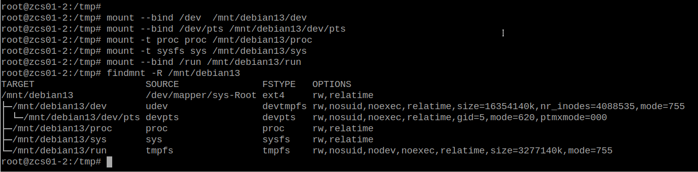
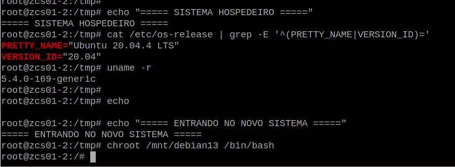
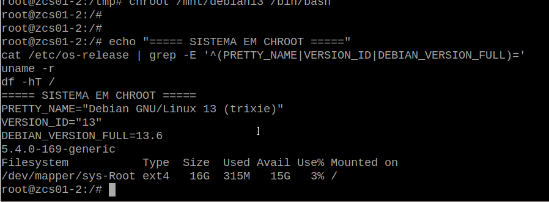

# Instalação e configuração do Debian

## 6. Instalação mínima do Debian 13

O Debian foi instalado diretamente no novo LV:

``` bash
debootstrap trixie /mnt/debian13 https://deb.debian.org/debian
```

Após a instalação:

``` bash
cat /mnt/debian13/etc/os-release
du -sh /mnt/debian13
df -hT /mnt/debian13
```

O sistema recém-instalado ocupava aproximadamente 315 MiB:

``` text
Debian GNU/Linux 13 (trixie)
DEBIAN_VERSION_FULL=13.6
```

------------------------------------------------------------------------

## 7. Preparação do `chroot`

Para administrar o novo Debian como um sistema real, foram disponibilizados os pseudo-filesystems necessários:

``` bash
mount --bind /dev /mnt/debian13/dev
mount --bind /dev/pts /mnt/debian13/dev/pts
mount -t proc proc /mnt/debian13/proc
mount -t sysfs sys /mnt/debian13/sys
mount --bind /run /mnt/debian13/run
```



Validação:

``` bash
findmnt -R /mnt/debian13
```

Entrada no sistema:

``` bash
chroot /mnt/debian13 /bin/bash
```



Dentro do chroot:

``` bash
cat /etc/os-release
uname -r
df -hT /
```

É importante entender que, nesse momento, `uname -r` ainda mostra o kernel do Ubuntu. O `chroot` troca o espaço de usuários, **não o kernel em execução**.



------------------------------------------------------------------------

## 8. Configuração básica do Debian

### Repositório

``` text
deb https://deb.debian.org/debian trixie main
```

Atualização:

``` bash
apt update
```

### Hostname

Foi definido o hostname definitivo do novo servidor.

Exemplo:

``` bash
echo "mailserver01" > /etc/hostname
```

### Timezone

``` text
America/Sao_Paulo
```

### Locale

Foi habilitado:

``` text
pt_BR.UTF-8 UTF-8
```

Com:

``` text
LANG=pt_BR.UTF-8
LC_ALL=pt_BR.UTF-8
```

Durante o `chroot` podem ocorrer warnings de locale devido às variáveis herdadas do sistema hospedeiro. O importante é confirmar que a locale foi efetivamente gerada:

``` bash
locale -a | grep -i pt_BR
```

------------------------------------------------------------------------

## 9. `fstab` inicial

O novo root foi identificado pelo UUID:

``` bash
blkid /dev/mapper/sys-Root
```

Exemplo:

``` text
UUID=<UUID-DO-NOVO-ROOT>
```

O `/etc/fstab` inicial do Debian ficou:

``` fstab
# Debian 13

UUID=<UUID-DO-NOVO-ROOT>  /      ext4  defaults  0  1
UUID=<UUID-DO-BOOT>       /boot  ext4  defaults  0  2
```

Validação obrigatória:

``` bash
findmnt --verify --verbose
```

O procedimento só prosseguiu após:

``` text
Success, no errors or warnings detected
```

------------------------------------------------------------------------

## 10. Configuração da rede

A interface ativa no Ubuntu utilizava um nome legado (`ethX`). Entretanto, o udev indicava que no Debian o nome previsível seria diferente.

A identificação foi feita com:

``` bash
ip -br link
ip -br addr
ip route

udevadm info /sys/class/net/eth4 | \
    grep -E 'ID_NET_NAME|ID_PATH|ID_NET_DRIVER'

ethtool -i eth4
```

Foram registrados:

-   MAC address;
-   barramento PCI;
-   driver;
-   nome previsível da interface.

O Debian utilizou `ifupdown`:

``` bash
apt install -y ifupdown
```

Exemplo de `/etc/network/interfaces`:

``` text
auto lo
iface lo inet loopback

# Interface de gerenciamento
auto enp5s0f0
iface enp5s0f0 inet static
    address 192.0.2.10/27
    gateway 192.0.2.1
```

> Os endereços acima são exemplos da faixa TEST-NET e não representam o ambiente original.

### Fixação adicional pelo MAC

Como o servidor estava a milhares de quilômetros e o acesso remoto dependia dessa interface, foi criada uma regra `.link`:

``` ini
[Match]
MACAddress=00:00:00:00:00:00

[Link]
Name=enp5s0f0
```

Arquivo:

``` text
/etc/systemd/network/10-management.link
```

A configuração foi validada com:

``` bash
ifquery enp5s0f0
ifquery --list
```

Também foi confirmado que não havia outro gerenciador concorrendo pela interface:

``` bash
systemctl is-enabled networking
systemctl is-enabled systemd-networkd
systemctl is-enabled NetworkManager
```

------------------------------------------------------------------------

## 11. Preparação do SSH

Como a migração era totalmente remota, o SSH foi tratado como componente crítico.

``` bash
apt install -y openssh-server sudo
```

Foi criado um usuário administrativo temporário:

``` bash
useradd -m -G sudo -c "Usuario Instalacao" install
passwd install
```

O `authorized_keys` existente foi copiado para o novo root, sem copiar a chave privada do servidor antigo.

``` bash
install -d -m 700 /mnt/debian13/root/.ssh
cp /root/.ssh/authorized_keys /mnt/debian13/root/.ssh/authorized_keys
chmod 600 /mnt/debian13/root/.ssh/authorized_keys
chown -R root:root /mnt/debian13/root/.ssh
```

Durante o primeiro boot foram temporariamente permitidos múltiplos métodos de acesso:

``` text
PermitRootLogin yes
PubkeyAuthentication yes
PasswordAuthentication yes
```

Validação:

``` bash
sshd -t
systemctl is-enabled ssh

sshd -T | grep -E \
'^(permitrootlogin|passwordauthentication|pubkeyauthentication) '
```

> Após validar definitivamente o novo sistema, essa configuração temporária deve ser endurecida conforme a política de segurança da organização.

------------------------------------------------------------------------
