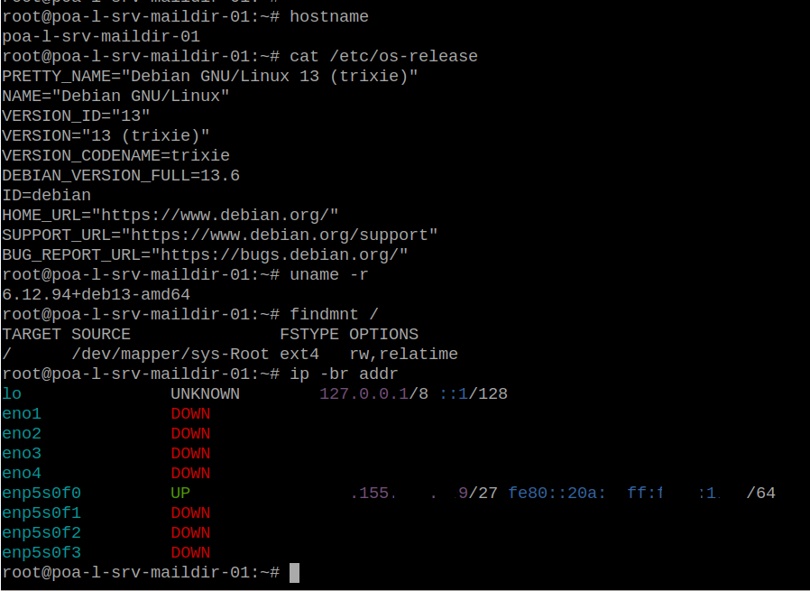

# Resultado e lições aprendidas

## 19. Resultado

O servidor inicializou corretamente no Debian 13.

Estado final observado:

``` text
Debian GNU/Linux 13 (trixie)
Debian 13.6
Kernel 6.12.94+deb13-amd64
Arquitetura x86_64
```

O novo root:

``` text
/dev/mapper/sys-Root
ext4
16 GiB
```

O `/boot`:

``` text
/dev/sdb2
ext4
~1 GiB
```

A interface previamente identificada pelo MAC foi corretamente apresentada pelo Debian como:

``` text
enp5s0f0
```

A rota default também foi instalada corretamente.

### Evidência do sistema após a migração


A captura demonstra simultaneamente:

-   hostname do novo sistema;
-   Debian 13.6;
-   kernel Debian;
-   root em `sys-Root`;
-   interface `enp5s0f0` ativa;
-   endereço IP configurado.

------------------------------------------------------------------------

## 20. Estado dos LVs antigos

Após a migração, os antigos LVs do Ubuntu foram deliberadamente preservados:

``` text
VG sys
├── Root    16 GiB   Debian atual - ATIVO
├── root    15 GiB   Ubuntu antigo
├── usr     20 GiB   Ubuntu antigo
├── var     30 GiB   Ubuntu antigo
├── home    14 GiB   Ubuntu antigo
└── tmp      5 GiB   Ubuntu antigo
```

Isso fornece uma janela adicional de recuperação após a migração.

Eles **não devem ser removidos imediatamente**.

Depois de um período adequado de homologação e confirmação de que nenhum dado precisa ser recuperado, esses LVs poderão ser removidos e o espaço reincorporado ao VG.

------------------------------------------------------------------------

## 21. Pontos críticos observados

### Não confundir `sys/root` com `sys/Root`

Durante a transição coexistiram:

``` text
/dev/mapper/sys-root    -> Ubuntu
/dev/mapper/sys-Root    -> Debian
```

Essa diferença é proposital, mas exige atenção absoluta nos comandos destrutivos.

### `chroot` não troca o kernel

Dentro do Debian instalado por `debootstrap`, antes do reboot:

``` bash
uname -r
```

continuava mostrando o kernel Ubuntu.

Isso é comportamento normal.

### Não confiar no nome antigo da interface

O Ubuntu utilizava nomenclatura `ethX`, enquanto o Debian adotou nomes previsíveis.

A identificação por:

``` bash
udevadm info
ethtool -i
MAC address
PCI address
```

foi essencial para preparar a rede antes do primeiro boot.

### Não depender somente do `os-prober`

O fallback Ubuntu foi criado explicitamente no GRUB.

Em uma migração remota, uma entrada de recuperação conhecida e inspecionável é preferível à descoberta automática.

### Não remover o sistema antigo imediatamente

O fato de o primeiro boot funcionar não significa que toda a carga de produção já esteja homologada.

Manter temporariamente os LVs antigos custa espaço, mas oferece uma possibilidade de recuperação muito mais valiosa durante os primeiros dias.

------------------------------------------------------------------------

## 22. Fluxo resumido

``` text
Ubuntu 20.04 em produção
        |
        v
levantamento completo
        |
        v
swapoff
        |
        v
remove LV swap
        |
        v
cria sys/Root
        |
        v
mkfs.ext4
        |
        v
debootstrap Debian 13
        |
        v
chroot
        |
        +--> hostname / locale / timezone
        +--> fstab
        +--> rede
        +--> SSH
        +--> LVM
        +--> initramfs
        +--> kernel Debian
        |
        v
limpeza controlada de /boot
        |
        v
/boot compartilhado temporariamente
        |
        +--> kernel Debian
        +--> kernel Ubuntu de fallback
        |
        v
GRUB Debian
        |
        +--> Debian 13 DEFAULT
        +--> Ubuntu 20.04 FALLBACK
        |
        v
checklist pré-reboot
        |
        v
reboot
        |
        v
Debian 13 operacional
        |
        v
período de homologação
        |
        v
remoção futura dos LVs Ubuntu
```

------------------------------------------------------------------------

## 23. Conclusão

A técnica permitiu instalar um sistema operacional completamente novo em um servidor remoto sem mídia de instalação e sem interromper o Ubuntu durante a preparação.

O ponto principal não foi o `debootstrap` isoladamente, mas a combinação de:

-   reaproveitamento controlado de um LV;
-   instalação paralela do novo userspace;
-   preparação de LVM e initramfs;
-   identificação determinística da interface de rede;
-   preparação antecipada do SSH;
-   compartilhamento temporário do `/boot`;
-   preservação do kernel antigo;
-   entrada GRUB explícita para rollback;
-   validações antes da gravação do bootloader;
-   manutenção temporária dos LVs antigos.

O resultado foi uma transição de Ubuntu 20.04 para Debian 13 em que praticamente toda a preparação ocorreu com o servidor original ainda operacional, deixando a indisponibilidade concentrada no reboot final.

Para servidores remotos sem acesso físico imediato, a parte mais importante dessa abordagem é justamente evitar que a migração dependa de uma única hipótese: rede, SSH, root filesystem, initramfs e bootloader foram validados separadamente antes da troca efetiva do sistema.
